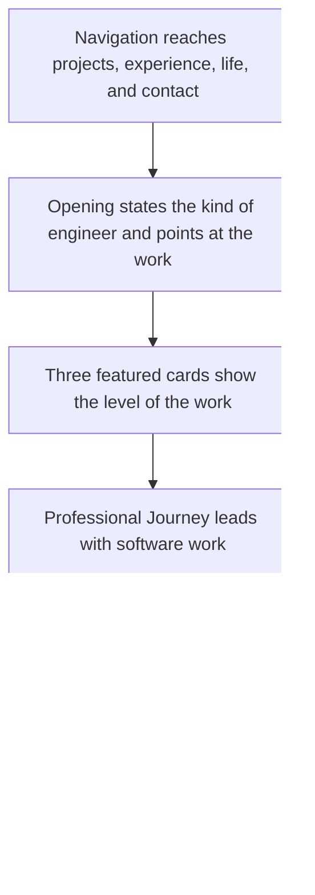
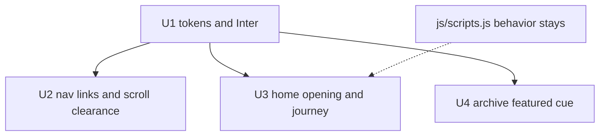

# Portfolio Redesign - Plan

## Goal Capsule

- **Objective:** A recruiter can spend about a minute on the home page, judge Ethan's skill from the work, and still get a sense of who he is, on a two-page portfolio that looks better than it does now.
- **Means:** Redesign the two existing pages in place (KTD1–KTD4).
- **Product authority:** Ethan Hartman. He confirmed product scope and the implementation choices on 2026-11-11.
- **Open blockers:** None.
- **Execution:** Edit the static pages and verify both in a browser. The repo stays without a package manager.
- **Who finishes:** The implementer, by landing U1 through U4 and completing the Verification Contract.
- **Stop:** Stop if a change would add a biographical through-line, a new page, a new video, or a test runner.

---

## Product Contract

Product Contract preservation: requirement text, Key Decisions, flows, and acceptance examples are unchanged. Summary and Means now name the approach in KTD1–KTD4. Outstanding Questions are answered by those KTDs.

### Summary

The existing home page and project archive are redesigned in place so they look better, and so a recruiter can spend about a minute judging Ethan's skill from the work and still get a sense of him. The work leads, using the projects, jobs, photos, and words already on the site.

The opening stays short, Professional Journey leads with software work, both pages share one loaded typeface and a new dark palette, and a phone can still reach the links already in the bar (KTD1–KTD4). Checking the result is a browser pass of both pages, including a narrow window. The work stays on these two pages and on the material already there.

### Problem Frame

Recruiters, and other people who want to know Ethan, are supposed to learn him from his website. The site is already acceptable, and no recruiter has named a problem with it. A minute on the home page can still pass without a clear judgment of his skill or a real sense of him. The opening is his name and three titles. The three featured projects show a short description and a badge, and the fuller account of the work is behind another click. Professional Journey begins with Pharmacy Technician at CVS Health and looks only acceptable. At 600px and below, the links to projects, experience, life, and contact are not shown.

### Key Decisions

- **Work leads, and the person still comes through.** (session-settled: user-directed — chosen over person-first, skill-only, and person-only: a recruiter judges skill from the work in about a minute and still gets a sense of Ethan.) Governs R1, R2, R3, R6.
- **Use the material already on the site.** (session-settled: user-directed — chosen over a new first-person through-line and a one-screen recruiter brief: projects, jobs, photos, and existing words stay, and no new biography is added.) Governs R2, R3, R6, R10.
- **Redesign how the pages look, including color.** (session-settled: user-approved — the user asked for a redesign that looks better and confirmed the current colors are replaceable.) Governs R7, R8, R9.
- **Redesign Professional Journey.** (session-settled: user-approved — the user asked the section to render and look better, then confirmed that pharmacy stays and software work leads.) Governs R4, R5, R7.

### Requirements

**The first minute**

- R1. On the home page, about a minute of reading is enough for a recruiter to judge Ethan's skill from the work and still get a sense of who he is, with the work leading that minute.
- R2. The opening states what kind of engineer Ethan is and points at the featured work, using words already on the site or a tightening of those words, and it adds no biographical through-line.
- R3. Each featured card lets a recruiter judge the level of that work without opening the detail, using words and proof already on the site: Crazy Dice shows 55k+ visits, Macro Studio shows that it is open source, and Smart Fan Controller shows bare-metal C and Assembly. The existing detail and video stay available.
- R4. The first role a reader meets in Professional Journey is software work already on the page.
- R5. Pharmacy Technician at CVS Health remains in Professional Journey, dated Nov 2021 – Jan 2026.
- R6. Off-Screen stays after the work and uses the existing life photos and videos, and it remains the Life destination in the navigation.

Home-page reading order:

Resume download, email copy, and project detail stay available per R13. They are not regions in this order.

**The look**

- R7. Professional Journey's entries are redesigned so they look better than they do now and lay out cleanly on a wide screen and at 600px wide and below.
- R8. Both pages receive a visual redesign covering layout, type, and color so they look better than they do now.
- R9. The home page and the archive use one visual system, including the typeface they actually render.

**The rest of the visit**

- R10. The archive keeps every project row it has now.
- R11. On the archive, a visitor can tell Crazy Dice, Macro Studio, and Smart Fan Controller from the other rows.
- R12. At a viewport width of 600px and below, navigation can reach projects, experience, life, and contact.
- R13. The resume can still be downloaded, ethan.h.hartman@gmail.com can still be copied, featured-project detail and its existing video can still be opened, and Off-Screen media can still be viewed closer.
- R14. The portfolio remains the two pages it has now, home and archive.
- R15. The contact area still says Ethan is open to new opportunities and collaborations.

### Key Flows

- F1. First minute
  - **Trigger:** A visitor opens the home page.
  - **Actors:** A recruiter, or another person curious about Ethan.
  - **Steps:** They read the opening, the three featured cards, and the start of Professional Journey. Off-Screen comes after that pass.
  - **Outcome:** Per R1.
  - **Covers:** R1, R2, R3, R4, R6
- F2. Narrow screen
  - **Trigger:** The viewport is 600px wide or below.
  - **Actors:** The same visitor.
  - **Steps:** They use the page navigation to open projects, experience, life, and contact.
  - **Outcome:** Per R12.
  - **Covers:** R12
- F3. Deeper project look
  - **Trigger:** The visitor wants more than the featured card.
  - **Actors:** The same visitor.
  - **Steps:** They open that project's detail and can play the video the page already has for it.
  - **Outcome:** Per R3 and R13, F1 did not depend on opening the detail.
  - **Covers:** R3, R13
- F4. Archive scan
  - **Trigger:** The visitor opens the archive.
  - **Actors:** The same visitor.
  - **Steps:** They see the full current list and can tell the three featured projects from the other rows.
  - **Outcome:** Per R10 and R11.
  - **Covers:** R10, R11

### Acceptance Examples

- AE1. Card proof without a further click
  - **Covers:** R1, R3
  - **Given:** The home page.
  - **When:** A visitor reads the three featured cards and does not open a project detail.
  - **Then:** Per R3, Crazy Dice shows 55k+ visits, Macro Studio shows that it is open source, and Smart Fan Controller shows bare-metal C and Assembly, and that is enough to judge the level of each project.
- AE2. Software work leads, and pharmacy stays
  - **Covers:** R4, R5
  - **Given:** Professional Journey.
  - **When:** A visitor starts reading that section.
  - **Then:** Per R4 and R5, the first role is software work already on the page, and Pharmacy Technician at CVS Health is still present with the dates Nov 2021 – Jan 2026.
- AE3. Narrow screen
  - **Covers:** R7, R12
  - **Given:** A viewport 600px wide.
  - **When:** The visitor views Professional Journey and uses the navigation.
  - **Then:** Per R7, the journey entries lay out cleanly, and per R12, projects, experience, life, and contact are reachable.
- AE4. Existing words and life media
  - **Covers:** R2, R6
  - **Given:** The redesigned home page.
  - **When:** A visitor reads the opening and Off-Screen.
  - **Then:** Per R2, the opening has no new biographical through-line, and per R6, Off-Screen still uses the existing life photos and videos.
- AE5. Archive and contact actions
  - **Covers:** R10, R11, R13, R15
  - **Given:** The archive and the home contact area.
  - **When:** A visitor scans the archive and uses the home page actions.
  - **Then:** Per R10 and R11, every current archive row is still there and the three featured projects are distinguishable. Per R13 and R15, the resume downloads, the email address can be copied, and the contact area still says Ethan is open to new opportunities and collaborations.
- AE6. One rendered system
  - **Covers:** R9
  - **Given:** The home page and the archive.
  - **When:** A visitor views each page.
  - **Then:** Per R9, both pages use the same visual system and the same rendered typeface.

### Scope Boundaries

- A new biographical through-line is out of scope (R2).
- A one-screen recruiter brief that drops Off-Screen or the full archive is out of scope (R6, R10).
- New projects, new photos, and new case-study media are out of scope.
- Recruiter surveys, analytics, and a measured response rate are out of scope. The bar is R1, R7, and R8.
- Pages beyond the current home and archive are out of scope (R14).
- Removing the CVS pharmacy entry, or changing its dates, is out of scope (R5).
- Making the resume or another site the primary way to learn Ethan is out of scope (R1).

Considered and not built:

- A script menu for the phone bar. KTD3 owns the choice. The archive page does not load `js/scripts.js`.
- A date-axis timeline. KTD2 owns the choice.
- A video on the Macro Studio detail. KTD7 owns the choice.
- A new typeface. KTD4 owns the choice.
- A visible email address or a mailto link. R13 stays the current copy control.
- A clipboard-failure fallback. Revisit only if a browser check shows the clipboard write failing.
- A no-JavaScript path for scroll reveals. The home page already depends on `js/scripts.js`, and the check runs with JavaScript on.
- Playwright, or any other test runner. The Verification Contract is a browser pass.

### Deferred to Follow-Up Work

- The marquee clones `#marquee-track` children three times while the stylesheet translates by half. Leave it unless a unit edits that track.
- `#contact` uses `reveal-down`, and that class has no rule. Leave it unless a later change edits that reveal.
- After a modal closes, an inline body overflow value overrides the stylesheet's horizontal clipping. Leave it unless a requirement needs the change.
- The Open Graph and Twitter description can drift from the page copy. This redesign does not rewrite them.

### Dependencies / Assumptions

- No recruiter has named a specific dislike. The work proceeds from Ethan's judgment and from R1, R7, and R8.
- About a minute means one pass through the opening, the three featured projects, and the start of Professional Journey, without opening project detail.
- The existing project writing and Off-Screen media are enough to carry who Ethan is.
- "Render and look better" for Professional Journey means presentation and layout per R7. It does not add jobs or change dates (R5).
- The RIT role already on the page is Innovation Fellow (Software Developer), Jun 2023 – Aug 2023.
- The Javlyn role already on the page is Research Internship (AR Development), Jul 2022 – Aug 2022.
- Senior Support Center Representative at Jack Morton Worldwide, Apr 2025 – Sep 2025, stays on the page and is not the software lead this plan names.
- The content sources are the media, resume, and project links already in the repo.
- Planning keeps the repo constraint in `AGENTS.md`: edit the static pages directly, and do not add a bundler or move modal HTML into a separate data file unless Ethan asks.

### Outstanding Questions

None remain. KTD1 answers the background video, KTD2 the journey order, KTD3 navigation at 600px, and KTD4 type and color.

### Sources / Research

- `index.html` hero — name, three titles, background video, project link, resume link. No biographical paragraph.
- `index.html` featured projects — Crazy Dice, Macro Studio, and Smart Fan Controller, with the fuller account in modal content. Button labels are Watch Trailer & Details, Learn More, and Watch Hardware Demo. Featured images sit outside `.project-modal-trigger`.
- `index.html` Professional Journey — current order is Pharmacy Technician, Jack Morton, RIT, then Javlyn. Each entry is a `.timeline-item`.
- `index.html` Off-Screen — "Life away from the keyboard." The nav label is Life. The section id is `#gallery`.
- `index.html` contact — copy that Ethan is open to new opportunities, and `#copy-email` with `data-email="ethan.h.hartman@gmail.com"`.
- `index.html` resume — `assets/files/Hartman_Ethan_CS_Resume.pdf` on a hero button. The archive resume link sits inside `.nav-links`.
- `archive.html` project table — 19 rows. Macro Studio, Crazy Dice, and Smart Fan Controller are marked Featured inside `.hide-mobile`.
- `assets/css/style.css` `:root` — current slate and cyan tokens, with Inter named as `--font-main`. Later rules override `.logo`, `.tech-stack`, `.contact-card`, and `.video-responsive`.
- `assets/css/style.css` — `#hero` is `height: 100vh`. At max-width 600px, `.nav-links` is `display: none`. At max-width 768px, `.hide-mobile` is hidden. `.pt-tech` asks for Fira Code.
- `index.html` and `archive.html` font links — the archive loads Inter at 300, 400, 600, and 800, plus Fira Code. The home page loads no font stylesheet. Stylesheet rules use `font-weight: 700`.
- `js/scripts.js` — home-only behavior for reveals, the lightbox, project modals, the hero video swap at 1024px, and email copy. The archive does not load this file.
- `js/footer.js` — injects the shared footer into `#footer-placeholder` on both pages.
- `AGENTS.md` — two static pages, one stylesheet, no build step unless asked.

---

## Planning Contract

### Key Technical Decisions

- KTD1. **Shorter opening.** The opening keeps the name and the three titles, the first project starts without a full extra screen, and the existing background video stays behind that shorter opening. (session-settled: user-approved — chosen over a full-viewport hero: a full-height opening can use the minute before any project is visible.) Cites R1, R2.
- KTD2. **Journey order and layout.** Reorder the four existing role blocks to the RIT role, then the Javlyn role, then Jack Morton, then pharmacy. Lay them out as stacked blocks with the same treatment, and do not present that order as the order of the dates. Pharmacy keeps equal visual presence and the dates in R5. (session-settled: user-approved — chosen over a chronological timeline: software work is what a recruiter meets first.) Cites R4, R5, R7.
- KTD3. **Phone links stay in the bar.** At 600px and below, the links already inside `.nav-links` stay visible on both pages, including the archive back link and the archive resume link. In-page targets clear the fixed bar. No new script. (session-settled: user-approved — chosen over a script menu: the archive page does not load `js/scripts.js`.) Cites R12, R13.
- KTD4. **One loaded typeface.** Both pages load Inter, including weight 700. Built With uses that same family. Layout and color carry the new look. (session-settled: user-approved — chosen over a new typeface: the pages should render the family they actually request.) Cites R8, R9.
- KTD5. **Warm-dark tokens.**
  - `--bg-dark` is `#141210`. `--bg-card` is `#1f1c18`. `--text-primary` is `#f6f1e8`. `--text-secondary` is `#b7aea3`. `--accent` is `#e0a15a`.
  - `--status` is `#8fa876`. The status badge uses it for its text, and a translucent wash of it for the background and border. It stays separate from the accent.
  - Nav, lightbox, journey chrome, badges, and hovers that hardcode the old slate, cyan, or status green use these tokens. That includes the later rules that override `.logo`, `.tech-stack`, `.contact-card`, and `.video-responsive`.
  - The pages stay dark enough that the hero video and the photos remain readable.
- KTD6. **Featured cue outside the hidden column.** Macro Studio, Crazy Dice, and Smart Fan Controller show the word Featured where it remains visible at 768px and below, outside `.hide-mobile`. All 19 rows and the category column stay. Cites R10, R11.
- KTD7. **Existing project detail only.** Macro Studio keeps its current docs and GitHub detail. Crazy Dice keeps its YouTube trailer. Smart Fan Controller keeps its Drive preview. The button labels stay Watch Trailer & Details, Learn More, and Watch Hardware Demo. Featured images stay outside `.project-modal-trigger`. Cites R3, R13.

### High-Level Technical Design

Shared tokens land first. Navigation, the home page, and the archive then use those tokens. `js/scripts.js` stays the owner of reveals, the lightbox, project modals, the hero video swap, and email copy. The archive does not load that script, so the phone bar cannot depend on it.

### Sequencing

U1 comes first. U2, U3, and U4 follow, in that order. They share `assets/css/style.css`, so that file is edited by one unit at a time.

### Constraints

- Keep the section ids `#hero`, `#projects`, `#experience`, `#gallery`, and `#contact`. The Life link still points at `#gallery`.
- Keep the modal and lightbox ids and classes that `js/scripts.js` already uses: `#lightbox`, `#lightbox-img`, `#project-modal`, `#modal-title`, `#modal-body`, `.lightbox-modal`, `.lightbox-close`, and `.active`.
- Keep `#copy-email`, `#hero-video`, `#marquee-track`, `#footer-placeholder`, and `.project-modal-trigger`. A class containing `reveal-` still starts hidden until `is-visible`.
- Leave `js/scripts.js` and `js/footer.js` unchanged unless a requirement cannot be met in HTML and CSS.
- Modal HTML stays on the trigger in `data-title` and `data-content`. `AGENTS.md` forbids a bundler and a separate modal data file.
- `.site-nav` stays fixed. The home resume stays the hero button. The archive resume stays inside `.nav-links`.

### Risks

- If the Google Fonts request fails, the fallback stack renders and R9 is missed. Check both pages on a normal network.
- A slate, cyan, or status-green literal left outside the tokens keeps the old chrome. KTD5 names the surfaces to move.
- Editing an earlier duplicate of `.logo`, `.tech-stack`, `.contact-card`, or `.video-responsive` does nothing, because a later block wins.
- Wrapping a featured image in `.project-modal-trigger` sends that click to the modal. KTD7 keeps the current split.
- Wrapped phone links can make `.site-nav` taller than `body.archive-page` padding. U2 raises that padding when the content sits under the bar.

---

## Implementation Units

### U1. Shared type and color tokens

- **Goal:** Both pages render Inter and the KTD5 palette.
- **Requirements:** R8, R9, AE6.
- **Dependencies:** None.
- **Files:** `index.html`, `archive.html`, `assets/css/style.css`. No test file. The repo has no test runner, and this plan does not add one.
- **Approach:**
  1. Add an Inter stylesheet link on `index.html` for weights 300, 400, 600, 700, and 800.
  2. On `archive.html`, drop Fira Code from the font link and add weight 700.
  3. Set `:root` to KTD5, including `--status`.
  4. Point `.pt-tech` at `var(--font-main)`.
  5. Move the hardcoded slate, cyan, and status green called out in KTD5 onto those tokens, including the status badge. Edit the later winning blocks.
- **Execution note:** Static page change. Verify in a browser. Do not add unit coverage.
- **Patterns to follow:** The existing `:root` custom properties and `cta-button` classes. One stylesheet for both pages, per `AGENTS.md`.
- **Test scenarios:**
  - Covers AE6. Open `index.html` and `archive.html` on a normal network. Both pages render Inter. A heading at weight 700 is Inter, not a synthesized bold.
  - Inspect the nav bar, a metric badge, the status badge, and a hover on each page. Those colors resolve from the KTD5 tokens. The rendered chrome is not `#38bdf8`, `#0f172a`, or `#4ade80`.
  - On the archive, a Built With cell uses the same family as the body. The page does not request Fira Code.
- **Verification:** R9 is true on both pages, and the surfaces named in KTD5 follow the new tokens.

### U2. Navigation at 600px and scroll clearance

- **Goal:** The links already in the bar stay reachable, and in-page targets clear that bar.
- **Requirements:** R12, R13, F2, AE3.
- **Dependencies:** U1.
- **Files:** `assets/css/style.css`. Change HTML only if the existing `.nav-links` markup cannot satisfy KTD3. No test file.
- **Approach:**
  1. Remove the max-width 600px rule that sets `.nav-links` to `display: none`. Keep the logo and the links in one bar, and let the links wrap onto another line. Do not turn the bar into a vertical menu.
  2. Give `#projects`, `#experience`, `#gallery`, and `#contact` enough `scroll-margin-top` to clear `.site-nav`.
  3. If wrapped links make the bar taller than `body.archive-page` top padding, increase that padding.
- **Execution note:** Static page change. Verify in a browser. Do not add unit coverage.
- **Patterns to follow:** The home `.nav-links` list and the archive `.nav-links` list. Do not add a script.
- **Test scenarios:**
  - Covers F2 / AE3. At 600px on the home page, Projects, Experience, Life, and Contact are visible. Each one scrolls its section clear of the bar. The hero name clears the bar, and the first featured card is not a full screen below the opening.
  - At 600px on the archive, Back to Portfolio and Resume are visible. Back opens the home projects section below the bar. Resume downloads `assets/files/Hartman_Ethan_CS_Resume.pdf`.
  - At about 1280px, those same links stay in the bar.
- **Verification:** R12 holds on the home page, and the archive back link and resume link hold at 600px per KTD3.

### U3. Home first minute

- **Goal:** The short opening, the three cards, and a software-led journey carry the first minute.
- **Requirements:** R1, R2, R3, R4, R5, R6, R7, R13, R15, F1, F3, AE1, AE2, AE4.
- **Dependencies:** U1.
- **Files:** `index.html`, `assets/css/style.css`. No test file. Leave `js/scripts.js` unchanged.
- **Approach:**
  1. Size `#hero` to its content, with top space that clears `.site-nav`. Keep `#hero-video` in that region. Leave the 1024px source swap in `js/scripts.js`.
  2. Reorder the four `.timeline-item` blocks to KTD2. Keep each block's copy, including the pharmacy dates.
  3. Restyle those blocks as equal stacked roles. Do not draw a date axis.
  4. Leave featured-card copy, badges, tech lists, button labels, and the archive link as they are. Keep featured images outside `.project-modal-trigger` per KTD7.
  5. Leave Off-Screen after the journey, and leave the contact sentence per R15.
- **Execution note:** Static page change. Verify in a browser. Do not add unit coverage.
- **Patterns to follow:** The current `.timeline-item` markup and the hero video element. Modal HTML stays on `.project-modal-trigger`.
- **Test scenarios:**
  - Covers F1 / AE4. At about 1280×800, the name and the three titles are visible, and the first featured card starts without a full extra screen of opening. The background video still plays behind that opening. The opening has no new biographical paragraph.
  - Covers AE1. Without opening a detail, Crazy Dice shows 55k+ visits, Macro Studio shows that it is open source, and Smart Fan Controller shows bare-metal C and Assembly. The buttons still read Watch Trailer & Details, Learn More, and Watch Hardware Demo.
  - Covers F3 / KTD7. The Crazy Dice detail still plays its YouTube trailer. The Smart Fan detail still shows its Drive preview. The Macro Studio detail has the docs and GitHub links it has now, and no video. A featured image still opens the lightbox. A gallery image still opens its modal.
  - Covers AE2. The first journey block is the RIT software role. Pharmacy Technician at CVS Health is still present, dated Nov 2021 – Jan 2026, with the same block treatment as the other three roles. The order is not laid out as a date axis.
  - At 600px, the four journey blocks stack on the screen without horizontal overflow.
  - Covers AE4. Off-Screen still follows the journey, the Life link still opens it, and its existing photos and videos still open closer.
  - The contact area still says Ethan is open to new opportunities and collaborations. The copy control still copies ethan.h.hartman@gmail.com. The hero resume button still downloads the resume PDF.
- **Verification:** A pass through the opening, the three cards, and the start of the journey meets R1, and R4, R5, R6, and R7 hold on a wide window and at 600px.

### U4. Archive featured cue

- **Goal:** The three featured rows stay recognizable when the category column is hidden.
- **Requirements:** R10, R11, F4, AE5.
- **Dependencies:** U1.
- **Files:** `archive.html`, `assets/css/style.css` if the cue needs a rule. No test file.
- **Approach:**
  1. Add the word Featured on the Macro Studio, Crazy Dice, and Smart Fan Controller rows, outside any `.hide-mobile` cell.
  2. Keep the existing category text, including the Featured wording already in those cells.
  3. Keep all 19 rows.
- **Execution note:** Static page change. Verify in a browser. Do not add unit coverage.
- **Patterns to follow:** The current `.pt-title` cell and the `.hide-mobile` category cell.
- **Test scenarios:**
  - Covers F4 / AE5. At 768px and at 600px, the category column is hidden, and Macro Studio, Crazy Dice, and Smart Fan Controller still show Featured. The other 16 rows do not.
  - At about 1280px, those three rows still show Featured, and the category column still shows its current text.
  - The table still has 19 project rows, with the same names and links as before this unit.
- **Verification:** R10 and R11 hold when `.hide-mobile` is hidden and when it is shown.

---

## Verification Contract

The repo has no test command and no package manager. Do not add one.

Open `index.html` and `archive.html` in a browser at about 600px, 768px, and 1280×800. Run the scenarios on U1, U2, U3, and U4. On the home page, also confirm the email copy, the resume download, the lightbox, and a project modal, per R13.

The final color pass checks the stacked journey blocks. It does not require the old date-axis border to remain. U3 owns that the order is not a date axis.

Check type on a normal network. If the Google Fonts request fails, the fallback stack shows and R9 is not met.

---

## Definition of Done

- The Verification Contract passes, including each unit's scenarios.
- CSS and HTML tried and then abandoned are not left in the diff.
- The Goal Capsule stop conditions still hold.
- U1 is done when both pages render Inter and the KTD5 tokens.
- U2 is done when KTD3 holds at 600px and on a wide window.
- U3 is done when the first-minute pass and the journey checks in its scenarios hold at 600px and at about 1280×800.
- U4 is done when the featured cue and all 19 rows hold at 768px and below, and on a wide window.
